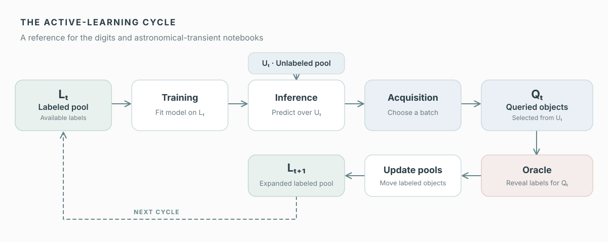

# Example notebooks

Hands-on examples of the reusable `al_pipeline` active-learning interfaces.
The notebooks are designed for participants on their own computers, in Jupyter
environments, or on shared computing systems. No particular institution or HPC
platform is required for the introductory example.

## The active-learning loop

Both notebooks illustrate the same pool-based active-learning cycle:



**Figure.** The model learns from the labeled pool $`L_t`$, scores candidates in the unlabeled pool $`U_t`$, and an acquisition policy selects a query batch $`Q_t`$. An oracle provides labels, which are added to form $`L_{t+1}`$ before the next cycle.

In **Notebook 01**, the oracle reveals held-back labels for handwritten digits as students explore acquisition rules. In **Notebook 02**, students examine **recorded AstroMiNN historical-replay results** from this workflow: archived labels were revealed during the original experiments, but the notebook itself analyzes saved metrics rather than rerunning training or acquisition.

## 01 — Pool-based active learning with handwritten digits

**[Open the student notebook](01_active_learning_digits.ipynb)**

A CPU-only introduction using scikit-learn's bundled handwritten-digits
dataset. It requires no astronomical data, external downloads, GPU, API token,
survey broker, or pretrained model checkpoint.

The notebook **already includes an executed core demonstration** (text,
tables, plots, and learning curves). Every TODO remains an exercise for the
student. In particular, the provided code for TODO 3–5 is scaffolding, *not*
a worked solution.

### Learning objectives

- Distinguish labeled, unlabeled, and pending pool states; keep validation and
  sealed test data separate.
- Calculate predictive entropy and margin uncertainty.
- Use `al_pipeline.core` scoring, selection, pool, acquisition loop, oracle,
  evaluation history, and plotting functionality.
- Compare random, entropy, and margin acquisition under the same labeled-set
  initialization and total acquisition budget.
- Investigate batch-size choices, paired repeated runs, and uncertain-but-diverse
  selection through optional exercises.

### Installation and running

Use Python 3.11 or newer. From a clone of this repository:

```bash
python -m pip install -e ".[teaching]"
```

Open `examples/01_active_learning_digits.ipynb` in JupyterLab, Jupyter
Notebook, VS Code, or another notebook frontend with the Python environment
where you installed `al-pipeline`. A graphical notebook frontend may need
to be installed or enabled separately.

If your editor requires a separately registered kernel:

```bash
python -m ipykernel install --user --name al-pipeline-teaching --display-name "AL Pipeline (CPU)"
```

The instructions above also apply on remote computing systems, subject to their
local environment and resource-use policies.

### Worked core and student exercises

The supplied notebook preserves the core's executed outputs for reading and
comparison. To reproduce them, choose **Restart Kernel and Run All** in your
notebook editor. The following defaults ensure that the core executes
successfully even though the exercises are not yet solved:

```python
RUN_EXERCISES = False
RUN_OPTIONAL_EXPERIMENTS = False
```

The five exercises are intentionally unfinished:

1. Implement the predictive entropy formula.
2. Analyze entropy versus margin and implement a margin scorer.
3. Compare different acquisition batch sizes for a fixed labeling budget.
4. Compare repeated, **paired** initial labeled sets and uncertainty results.
5. Compare entropy with an uncertainty-plus-diversity selector.

After completing TODO 1–2, enable `RUN_EXERCISES=True` to run their checks.
For TODO 3–5, complete their guarded cells first, then enable
`RUN_OPTIONAL_EXPERIMENTS=True`. These later exercises perform additional model
fits; they are not required to reproduce the core notebook. The repository does
not distribute an instructor solutions notebook.

### Automated verification

From the repository root, the CPU runner saves a newly executed copy without
overwriting the published notebook:

```bash
python scripts/examples/execute_digits_notebook.py \
  --mode core \
  --output digits_core_local.ipynb
```

To test the unsolved student notebook's structure and core execution:

```bash
python -m pip install pytest
python -m pytest -q tests/examples/test_digits_notebook.py
```

An optional runner mode is available *after* solutions have been completed,
and the instructor-only mode requires a locally supplied, unpublished
solutions notebook. Neither mode is necessary for participants.

### Experimental design and limitations

The main experiment uses 50 initial labels (five per digit) and three
policies—random, predictive entropy, and top-two margin—each acquiring 160
additional labels over eight cycles. The classifier is multinomial logistic
regression; the results are a teaching demonstration, not a claim that one
acquisition policy is universally superior.

The simulated oracle stores the candidate ground truth and reveals only labels
requested by a selection. Candidate labels are not given to the acquisition
scorer. Policies are chosen using validation macro-F1; the test split is used
for one final evaluation. TODO 4 varies the balanced initial set *across*
replicates but holds it fixed *between* policies within a replicate.


## 02 — Historical active learning for astronomical transients

**[Open the executed student notebook](02_applecider_astronomy_active_learning.ipynb)**

A self-contained **CPU-only analysis laboratory** using real, completed AstroMiNN acquisition experiments. Students analyze archived validation trajectories rather than train an astronomical model. The notebook needs no GPU, network access, images, checkpoints or connection to Delta.

The bundled [data tables](data/README.md) contain 1,020 aggregate validation measurements across 51 nine-cycle trajectories, 2,550 class-level measurements (precision, recall, F1 and support), and matched acquisition-overlap summaries at cycle 2. No object identifiers, raw predictions or hidden candidate labels are distributed.

### Guided learning sequence

- Understand the labeled-set and acquisition budget.
- Compare entropy, entropy + diversity and BADGE in a legible three-curve figure.
- Examine BALD, TAILOR and uniform mixture as a separate, provisional cross-suite comparison.
- Study **TDE and CV** class-level performance using recorded evaluations.
- Read a presentation-style **cumulative Jaccard overlap matrix** through cycle 2, excluding the shared initial labeled set.
- Explore seed variation and sensitivity to an alternative initial labeled set.
- Complete four unsolved exercises on label efficiency, policy rankings, variability and comparability.

Figures use the muted palette; the main learning curves have no crowded uncertainty bands. The notebook includes **six executed figures** for GitHub preview.

### Run entirely offline

```bash
python -m pip install -e ".[teaching]"
python scripts/examples/execute_astro_notebook.py --output astro_school_local.ipynb
```

Alternatively open the student notebook in Jupyter or VS Code and choose **Restart Kernel and Run All**.

```bash
python -m pytest -q tests/examples/test_astro_notebook.py tests/examples/test_astro_replay_data.py
```

**Interpretation:** comparisons across independently executed experiment suites are descriptive unless the complete protocols are verified equivalent. The alternative initial labeled set is shown separately. The notebook reads recorded data; it does not simulate new acquisitions or retrain AstroMiNN.
